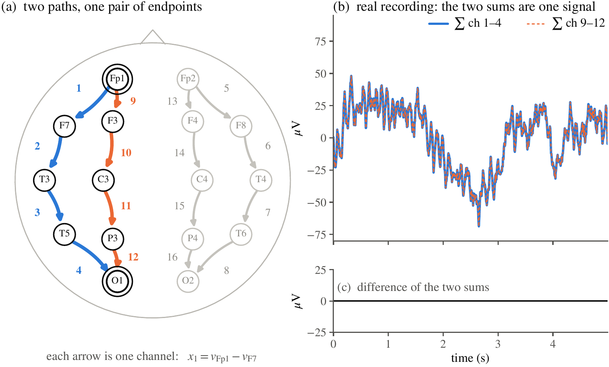
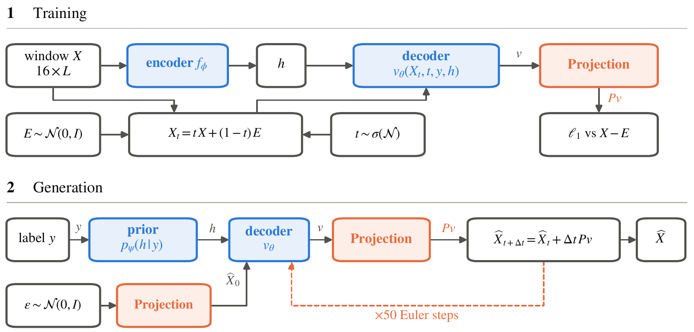

# MontageFlow: Physically Valid High Fidelity EEG Generation
This codebase provides a PyTorch implementation of:

>**MontageFlow: Physically Valid High Fidelity EEG Generation.**  
[](https://arxiv.org/abs/2610.14507) [](https://huggingface.co/sudarshanregmi/MontageFlow)  
Sudarshan Regmi, Nabaraj Subedi, Arvind Pillai, Yu Yvonne Wu, Yuliang Chen, Michael V. Heinz, Lisa Marsch, Nicholas C. Jacobson, Andrew Campbell

## Abstract
Generative modeling offers a promising solution to the scarcity of labeled clinical electroencephalography (EEG) data under strict privacy constraints. Although recent generative models report substantial improvements in generation fidelity, we show that these gains conceal a categorical failure. EEG is not an arbitrary multichannel signal: each channel records the voltage difference between two scalp electrodes. So, real recordings satisfy exact linear identities among their channels. Current generators invariably violate these identities, yet this has gone unnoticed. We therefore propose **MontageFlow**, a flow-matching model that enforces these identities by restricting its output to signals that satisfy them. We find that ensuring validity improves fidelity too. Furthermore, to retain the EEG characteristics that oversmoothing washes out, we also condition the model on a physiological state vector encoded from the whole EEG window. For generation, this vector is drawn from a prior fitted in latent space. Across 3 large-scale benchmarks, our model improves TS-FID by 1.6–3.6× over the closest rival while ensuring validity.

<p align="center">
  
</p>

**Figure 1. The bipolar montage induces two exact linear constraints.** (a) Each channel is an oriented
difference between two electrode potentials. Channels 1–4 and 9–12 form two paths from Fp1 to O1, and
channels 5–8 and 13–16 do the same from Fp2 to O2. Either path sums to the potential difference between
its endpoints. (b) The two left path sums overlap on a real TUSZ window, and (c) their difference is
numerically zero.

<p align="center">
  
</p>

**Figure 2. Overview of MontageFlow.** During training, an encoder $f_\phi$ maps an EEG window $X$ to a
global latent $h$. The decoder receives the current flow state $X_t$, flow time $t$, class label $y$, and
perturbed latent $\tilde h$, and predicts a velocity field. After encoder-decoder training, a
class-conditional rectified-flow prior $p_\psi(h \mid y)$ is fitted to the encoded training latents and
replaces the encoder during generation. The predicted velocity is projected onto $\ker A$. At inference,
the Gaussian source is also projected to guarantee valid EEG.

## Setup

```bash
git clone https://github.com/sudarshanregmi/MontageFlow.git
cd MontageFlow
pip install torch --index-url https://download.pytorch.org/whl/cu128   # pick the build for your CUDA
pip install -r requirements.txt
pip install -e .
```

## Data

We use three corpora from the Temple University Hospital EEG collection: TUAB v3.0.1 (normal vs.
abnormal), TUEV v2.0.1 (six event types) and TUSZ v2.0.6 (seizure vs. background). Access requires a
data use agreement with TUH, so the data is not distributed here. Once you have it:

1. Cut the EDF recordings into windows. Each script writes one pickle file per window, with 16
   channels in the TCP bipolar montage at 200 Hz: 10 s windows for TUAB, 5 s for TUEV and TUSZ.
   `--input-dir` is the corpus's `edf` folder, which holds `train/` and `eval/`. Add
   `--num-workers N` to use N processes.

```bash
python scripts/preprocess_tuab.py --input-dir /path/to/tuab/edf --output-dir /path/to/windows/tuab
python scripts/preprocess_tuev.py --input-dir /path/to/tuev/edf --output-dir /path/to/windows/tuev
python scripts/preprocess_tusz.py --input-dir /path/to/tusz/edf --output-dir /path/to/windows/tusz
```

2. Pack the windows into arrays. Folders that are missing under `--src` are skipped without a message:

```bash
python scripts/prepare_data.py --src /path/to/windows --out data
```

This writes `data/<dataset>/<split>/X.npy` (windows in microvolts) and `y.npy` (labels). The
downstream test also needs the validation split, so add `--splits train val test` if you plan to run it.
Labels: TUAB 0 normal, 1 abnormal; TUSZ 0 background, 1 seizure; TUEV 0 SPSW, 1 GPED, 2 PLED,
3 EYEM, 4 ARTF, 5 BCKG.

## Pretrained models

MontageFlow and MontageDiff checkpoints for the three corpora are on Hugging Face at
[sudarshanregmi/MontageFlow](https://huggingface.co/sudarshanregmi/MontageFlow): `montageflow_tusz`,
`montageflow_tuev`, `montageflow_tuab`, `montagediff_tusz`, `montagediff_tuev` and `montagediff_tuab`.
Each includes its fitted latent prior.

```python
import montageflow

model, prior, config = montageflow.load("sudarshanregmi/MontageFlow/montageflow_tuab")   # or a local release directory
x = montageflow.generate(model, labels=[0, 1, 1], prior=prior)
# x: (3, 16, 2000) float32, in units of 100 µV (multiply by 100 for microvolts)
```

MontageFlow generates with 50 Euler steps. MontageDiff, a DDPM with MontageFlow's montage projection and latent conditioning, generates with 50 DDIM steps. The output satisfies both montage constraints up to floating-point error.

## Training

Each run combines a method config and a dataset config. On one GPU, or on four GPUs with `torchrun`:

```bash
python scripts/train.py configs/montageflow.yaml --data configs/data/tuab.yaml --out runs/montageflow_tuab
torchrun --nproc_per_node 4 scripts/train.py configs/montageflow.yaml --data configs/data/tuab.yaml --out runs/montageflow_tuab
```

Settings can be overridden on the command line, e.g. `train.steps=1000`. Training resumes from the
latest checkpoint in `--out`. The defaults are the paper's settings: batch 128, learning rate 5e-5
after a 2.5-epoch warmup, EMA 0.9999, class-balanced sampling, about 160k steps.

After training any model with a latent (MontageFlow, MontageDiff, ablation rows 4 and 5, projected training noise, L2 loss), fit its latent prior and, optionally, export a release directory:

```bash
python scripts/fit_prior.py runs/montageflow_tuab/ckpt_0161999.pt
python scripts/export.py runs/montageflow_tuab/ckpt_0161999.pt release/tuab
```

| Config | Paper |
|---|---|
| `configs/montageflow.yaml` | MontageFlow |
| `configs/montagediff.yaml` | MontageDiff |
| `configs/baselines/vanilla_fm.yaml` | Vanilla flow matching |
| `configs/baselines/vanilla_diffusion.yaml` | Vanilla diffusion |
| `configs/baselines/jet.yaml`, `jet_x.yaml` | JET, JET<sup>×</sup> |
| `configs/baselines/eeggan.yaml` | EEG-GAN |
| `configs/ablations/ladder_1_x_prediction.yaml`, `ladder_2_velocity.yaml`, `ladder_4_latent.yaml`, `ladder_5_latent_noise.yaml` | Ablation table, rows 1, 2, 4 and 5 (row 3 uses `vanilla_fm.yaml`, row 6 uses `montageflow.yaml`) |
| `configs/ablations/projected_noise.yaml`, `l2_loss.yaml` | Projected training noise, L2 loss |

For the "inference only" row of the post-hoc projection table, evaluate the row-5 model with
`--project`. For the prior-label ablation, fit the prior without labels:
`python scripts/fit_prior.py <ckpt> prior.label_conditioned=false --out prior_no_label.pt`.

## Evaluation

```bash
python scripts/evaluate.py sudarshanregmi/MontageFlow/montageflow_tuab --split data/tuab/test --out results/montageflow_tuab_test.json
```

By default the script uses the whole split: it generates one window for every real window, with
that window's label. `--n 2000` uses a random subset of 2,000 real windows instead. The output JSON
reports TS-FID, the montage index, shape correlation and the five physiological distances (PSD slope, envelope, Hjorth
activity, Hjorth mobility, drift). To evaluate a training checkpoint whose `prior.pt` is not in the same
folder, pass `--prior <prior.pt>`.

## Downstream utility

To check whether generated windows are useful for training, `scripts/downstream.py` fine-tunes a
CBraMod classifier on 5,000 generated windows per class and tests it on the real test split. It reports
balanced accuracy at the epoch with the best validation score. Pass `real` instead of a model
to train on the same number of real windows. The paper reports the mean over seeds 0, 1 and 2.

The script needs a clone of [CBraMod](https://github.com/wjq-learning/CBraMod) with its pretrained
weights at `pretrained_weights/pretrained_weights.pth` inside the clone.

```bash
mkdir -p samples
python scripts/downstream.py sudarshanregmi/MontageFlow/montageflow_tuab --data data/tuab --cbramod ~/CBraMod --seed 0 \
    --cache samples/downstream_montageflow_tuab.npz --out results/downstream_montageflow_tuab_s0.json
```

`--cache` saves the generated windows to that file and reuses them if it exists, so seeds 1 and 2 train on the same windows as seed 0. Use one cache file per model, because an existing file is reused whichever model you pass.

## Tests

```bash
pytest tests
```

## Citation

```bibtex
@misc{regmi2026montageflow,
  title         = {MontageFlow: Physically Valid High Fidelity {EEG} Generation},
  author        = {Regmi, Sudarshan and Subedi, Nabaraj and Pillai, Arvind and Wu, Yu Yvonne and Chen, Yuliang
                   and Heinz, Michael V. and Marsch, Lisa and Jacobson, Nicholas C. and Campbell, Andrew},
  year          = {2026},
  eprint        = {2610.14507},
  archivePrefix = {arXiv},
  primaryClass  = {cs.AI},
  url           = {https://arxiv.org/abs/2610.14507}
}
```
